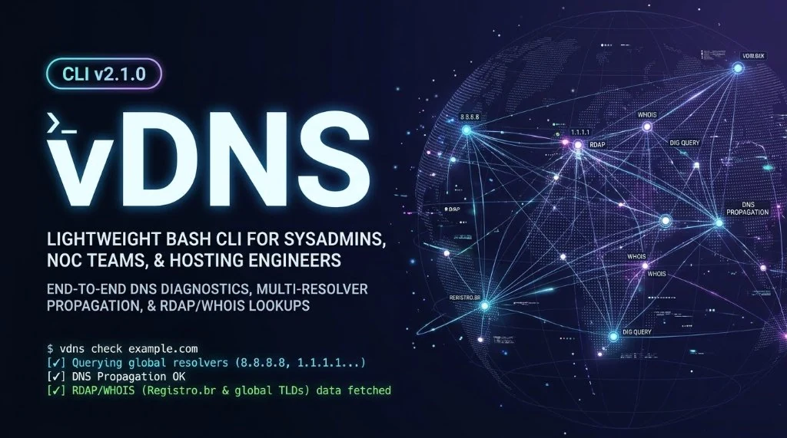

# vdns



`vdns` é uma CLI em Bash para diagnóstico completo de DNS e consulta de registro de domínios. Projetada para sysadmins, equipes de NOC e engenheiros de hospedagem, combina consultas autoritativas via `dig` com consultas **RDAP** oficiais no **Registro.br** (`rdap.registro.br`) e em TLDs internacionais (`rdap.org`), com saída estruturada em `table`, `json` e `csv`.

## Principais Recursos

- **Integração oficial com o RDAP do Registro.br** (`https://rdap.registro.br/domain/<dominio>`): extrai status do domínio, datas de registro, alteração e expiração, estado do DNSSEC (`signed`/`unsigned`), entidade/titular e nameservers delegados.
- **Consulta RDAP global** (`https://rdap.org/domain/<dominio>`): segue automaticamente os redirecionamentos do bootstrap RDAP da IANA para domínios internacionais.
- **Parsing JSON resiliente**: utiliza `jq` quando disponível, faz fallback automático para `python3` (biblioteca padrão `json`) e degrada com segurança para `grep`/`sed` POSIX.
- **Fallback automático para WHOIS** (ativado por padrão; desative com `--no-whois-fallback`): detecta ccTLDs sem servidor RDAP no bootstrap da IANA (ex.: `.io`, `.de`, `.me`, `.co`) ou rate-limit (`429`) e recorre automaticamente ao `whois` na porta 43, evitando falsos positivos de domínio "não registrado".
- **Diagnóstico completo de DNS e e-mail**: NS, NS da zona pai (com suporte a Public Suffix List), NSR autoritativo, `A`/`AAAA`/`www`, ping ICMP, MX, reverso PTR, SPF, DMARC, DKIM com seletor customizável (`--dkim-selector`), registros SRV do Microsoft 365 / Lync, dump em formato de zona BIND (`-B`) e teste de propagação em resolvers públicos (`1.1.1.1`, `8.8.8.8`, `9.9.9.9`, `208.67.222.222`).
- **Saídas estruturadas para automação**: `-F table|json|csv` (ou `--json` / `--csv`), `-q/--quiet`, `--no-color` e salvamento limpo sem códigos ANSI (`-s/--save`) com permissão `chmod 600`.
- **Validação defensiva de entrada**: normaliza URLs e pontos finais e rejeita domínios malformados antes de qualquer requisição.

## Requisitos

- `bash` (4.0+)
- `dig` (`bind-utils` / `dnsutils`)
- `curl`
- Utilitários POSIX básicos: `awk`, `sed`, `grep`, `sort`, `cut`, `paste`
- Opcionais: `jq` ou `python3` (para extração completa dos campos RDAP), `whois` (para `--whois-fallback`), `ping`

## Instalação

```bash
git clone https://github.com/sr00t3d/vdns.git
cd vdns
chmod +x vdns
sudo install -m 0755 vdns /usr/local/bin/vdns
```

## Uso

```bash
vdns [opções] <dominio>
```

### Comandos Mais Usados

```bash
# Consulta completa (RDAP + NS + A/AAAA/www + ping + MX + PTR + SPF/DMARC + DKIM + Office SRV)
vdns -a perciocastelo.com.br

# Somente consulta RDAP no Registro.br
vdns -b perciocastelo.com.br

# Registro automático + DNS + propagação em JSON
vdns -c -w -n -l -F json example.com

# Saída em CSV para planilhas ou inventário
vdns -c -w -n -F csv perciocastelo.com.br

# DKIM com seletor personalizado
vdns -k --dkim-selector google example.com

# Saída em formato de zona BIND
vdns -B example.com

# Salvar relatório limpo em <dominio>.txt (chmod 600)
vdns -a -s example.com
```

### Opções da CLI

| Flag | Descrição |
|---|---|
| `-a`, `--all` | Consulta completa (registro + DNS + e-mail + ping + Office SRV) |
| `-n`, `--ns` | Nameservers, IPs resolvidos e NS da zona pai |
| `-d`, `--nsr` | Resposta NS autoritativa direto do servidor de nomes do domínio |
| `-w`, `--www` | Registros `A`, `AAAA` e `A`/`CNAME` de `www` |
| `-p`, `--ping` | Teste de conectividade ICMP (1 pacote, timeout de 2s) |
| `-m`, `--mx` | Registros MX |
| `-r`, `--reverse` | DNS reverso (PTR) do registro `A` principal |
| `-f`, `--spf` | Registros TXT de SPF e DMARC |
| `-k`, `--dkim` | Registro TXT de DKIM (seletor padrão: `default`) |
| `--dkim-selector <nome>` | Seletor DKIM customizado |
| `-o`, `--office` | Registros SRV do Microsoft 365 / Lync |
| `-b`, `--br` | Consulta RDAP no Registro.br (domínios `.br`) |
| `-i`, `--intl` | Consulta RDAP global via `rdap.org` |
| `-c`, `--registrar` | Consulta automática de registro (`.br` -> Registro.br, outros -> `rdap.org`) |
| `-l`, `--propagation` | Teste de propagação na Cloudflare, Google, Quad9 e OpenDNS |
| `-B`, `--bind` | Saída em formato de zona BIND (`$ORIGIN` + registros) |
| `-F`, `--format <fmt>` | Formato de saída: `table` (padrão), `json`, `csv` |
| `--json` / `--csv` | Atalhos para `-F json` / `-F csv` |
| `--whois-fallback` | Ativa fallback automático para `whois` na porta 43 (padrão) |
| `--no-whois-fallback` | Desativa fallback automático para `whois` (somente RDAP estrito) |
| `--insecure` | Permite `curl -k` no TLS do RDAP (desativado por padrão) |
| `-s`, `--save` | Salva relatório sem ANSI em `<dominio>.txt` (`chmod 600`) |
| `-q`, `--quiet` | Oculta o cabeçalho decorativo |
| `--no-color` | Desativa cores ANSI (também respeita `NO_COLOR`) |
| `-u`, `--update` | Verifica se há versão mais recente no GitHub |
| `-V`, `--version` | Exibe a versão e encerra |
| `-h`, `--help` | Exibe esta ajuda e encerra |

## Execução Direta & Windows PowerShell

### Linux / macOS (Execução Direta)
```bash
bash <(curl -fsSL https://raw.githubusercontent.com/sr00t3d/vdns/main/vdns) -a example.com
```

### Windows (PowerShell `vdns.ps1`)
Zero dependências externas — compatível com **Windows PowerShell 5.1+** e **PowerShell 7+**:

```powershell
# Execução direta (sem clonar)
& ([scriptblock]::Create((irm https://raw.githubusercontent.com/sr00t3d/vdns/main/vdns.ps1))) -All example.com

# Execução local
.\vdns.ps1 -All perciocastelo.com.br
.\vdns.ps1 -Registrar -Dns -Propagation example.com -Output json
.\vdns.ps1 -All github.io -Output csv
```

## Exemplo de Saída Real

### Consulta RDAP Registro.br + DNS Completo (`vdns -a --no-color perciocastelo.com.br`)

```text
=====================================================
 vdns v2.0.0 | Domain: perciocastelo.com.br | 2026-11-20T08:10:41Z
=====================================================

---- REGISTRAR (RDAP) ----
[OK] perciocastelo.com.br is registered (registro.br-rdap).
  Endpoint   : https://rdap.registro.br/domain/perciocastelo.com.br (HTTP 200)
  Status     : active
  Registered : 2026-02-11T12:07:18Z
  Updated    : 2026-06-08T16:03:20Z
  Expires    : 2027-02-11T12:07:18Z
  DNSSEC     : signed
  Entity     : Percio Andrade Castelo Branco
  Delegated  : rosalyn.ns.cloudflare.com, sonny.ns.cloudflare.com

---- NS ------------------
[OK] Nameservers for perciocastelo.com.br:
  - rosalyn.ns.cloudflare.com (172.64.34.59,108.162.194.59,162.159.38.59)
  - sonny.ns.cloudflare.com (108.162.195.66,162.159.44.66,172.64.35.66)
[OK] Parent zone NS (perciocastelo.com.br -> com.br):
  - a.dns.br
  - b.dns.br
  - c.dns.br
  - d.dns.br
  - e.dns.br
  - f.dns.br

---- WWW / IP ------------
[OK] A (perciocastelo.com.br): 172.64.80.1
[OK] AAAA (perciocastelo.com.br): 2606:4700:130:436c:6f75:6466:6c61:7265
[OK] A (www.perciocastelo.com.br): 172.64.80.1

---- MX ------------------
perciocastelo.com.br.	600	IN	MX	10 mx.zoho.com
perciocastelo.com.br.	600	IN	MX	20 mx2.zoho.com
perciocastelo.com.br.	600	IN	MX	50 mx3.zoho.com
```

### Saída Estruturada em JSON (`vdns -c -w -n -l -F json example.com`)

```json
{
  "tool": "vdns",
  "version": "2.0.0",
  "timestamp": "2026-11-20T08:10:43Z",
  "domain": "example.com",
  "parent_zone": "com",
  "registrar": {
    "source": "rdap.org",
    "endpoint": "https://rdap.org/domain/example.com",
    "http_code": "200",
    "state": "registered",
    "status": "client delete prohibited, client transfer prohibited, client update prohibited",
    "registered": "1995-08-14T04:00:00Z",
    "updated": "2026-08-14T08:01:43Z",
    "expires": "2027-08-13T04:00:00Z",
    "dnssec": "signed",
    "entity": "RESERVED-Internet Assigned Numbers Authority",
    "delegated_ns": "ELLIOTT.NS.CLOUDFLARE.COM, HERA.NS.CLOUDFLARE.COM"
  },
  "dns": {
    "nameservers": "elliott.ns.cloudflare.com,hera.ns.cloudflare.com",
    "a": "104.20.23.154",
    "aaaa": "2606:4700:10::6814:179a",
    "www_a": "104.20.23.154,172.66.147.243",
    "spf": "\"v=spf1 -all\"",
    "dmarc": "\"v=DMARC1;p=reject;sp=reject;adkim=s;aspf=s\""
  },
  "propagation": [
    { "resolver": "1.1.1.1", "name": "Cloudflare", "a": "104.20.23.154,172.66.147.243" },
    { "resolver": "8.8.8.8", "name": "Google", "a": "172.66.147.243,104.20.23.154" },
    { "resolver": "9.9.9.9", "name": "Quad9", "a": "104.20.23.154,172.66.147.243" },
    { "resolver": "208.67.222.222", "name": "OpenDNS", "a": "104.20.23.154,172.66.147.243" }
  ]
}
```

## Licença

Licenciado sob a [Apache License 2.0](LICENSE).

English: [README.md](README.md)