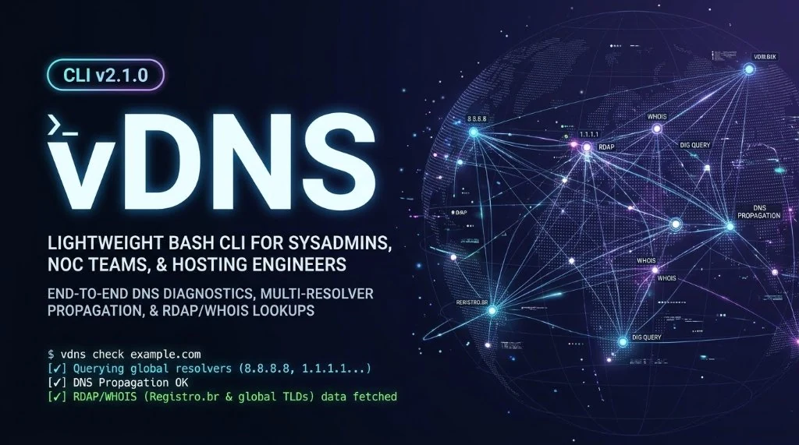

# vdns



`vdns` is a lightweight Bash CLI for end-to-end DNS and domain registrar diagnostics. Built for sysadmins, NOC teams, and hosting engineers, it combines authoritative `dig` queries with official **RDAP** lookups for `.br` domains (`rdap.registro.br`) and international TLDs (`rdap.org`), plus structured `table`, `json`, and `csv` outputs.

## Key Features

- **Official Registro.br RDAP integration** (`https://rdap.registro.br/domain/<domain>`): parses domain status, registration/update/expiration dates, DNSSEC state (`signed`/`unsigned`), entity/registrar, and delegated nameservers.
- **Global RDAP lookup** (`https://rdap.org/domain/<domain>`): follows IANA RDAP bootstrap redirects automatically for international TLDs.
- **Zero mandatory JSON parser dependency**: parses RDAP JSON via `jq`, falls back automatically to `python3` stdlib `json`, and degrades gracefully to POSIX `grep`/`sed`.
- **Automatic WHOIS fallback** (enabled by default; disable with `--no-whois-fallback`): detects ccTLDs without an IANA RDAP bootstrap server (e.g. `.io`, `.de`, `.me`, `.co`) or RDAP rate-limits (`429`) and falls back seamlessly to port-43 `whois` without false "unregistered" results.
- **Complete DNS & email diagnostics**: NS, parent-zone NS (Public Suffix List aware), authoritative NSR, `A`/`AAAA`/`www`, ICMP ping, MX, reverse PTR, SPF, DMARC, custom-selector DKIM (`--dkim-selector`), Microsoft 365 / Lync SRV, BIND-style zone dump (`-B`), and multi-resolver propagation (`1.1.1.1`, `8.8.8.8`, `9.9.9.9`, `208.67.222.222`).
- **Structured automation outputs**: `-F table|json|csv` (or `--json` / `--csv`), `-q/--quiet`, `--no-color`, and ANSI-stripped `-s/--save` reports created with `chmod 600`.
- **Input hardening**: normalizes URLs/trailing dots and validates domain syntax before any network call.

## Requirements

- `bash` (4.0+)
- `dig` (`bind-utils` / `dnsutils`)
- `curl`
- Core POSIX utilities: `awk`, `sed`, `grep`, `sort`, `cut`, `paste`
- Optional: `jq` or `python3` (for full RDAP field extraction), `whois` (for `--whois-fallback`), `ping`

## Installation

```bash
git clone https://github.com/sr00t3d/vdns.git
cd vdns
chmod +x vdns
sudo install -m 0755 vdns /usr/local/bin/vdns
```

## Usage

```bash
vdns [options] <domain>
```

### Common Commands

```bash
# Full lookup (RDAP + NS + A/AAAA/www + ping + MX + PTR + SPF/DMARC + DKIM + Office SRV)
vdns -a perciocastelo.com.br

# Registro.br RDAP lookup only
vdns -b perciocastelo.com.br

# Auto registrar + DNS + propagation in JSON format
vdns -c -w -n -l -F json example.com

# CSV output for inventory or spreadsheets
vdns -c -w -n -F csv perciocastelo.com.br

# Custom DKIM selector
vdns -k --dkim-selector google example.com

# BIND-style zone output
vdns -B example.com

# Save clean report to <domain>.txt (chmod 600)
vdns -a -s example.com
```

### CLI Options

| Flag | Description |
|---|---|
| `-a`, `--all` | Full lookup (registrar + DNS + mail + ping + Office SRV) |
| `-n`, `--ns` | Nameservers, resolved IPs, and parent zone NS |
| `-d`, `--nsr` | Authoritative NS answer directly from domain NS |
| `-w`, `--www` | `A`, `AAAA`, and `www` `A`/`CNAME` records |
| `-p`, `--ping` | ICMP reachability check (1 packet, 2s timeout) |
| `-m`, `--mx` | MX records |
| `-r`, `--reverse` | Reverse DNS (PTR) for primary `A` record |
| `-f`, `--spf` | SPF and DMARC TXT records |
| `-k`, `--dkim` | DKIM TXT record (default selector: `default`) |
| `--dkim-selector <name>` | Custom DKIM selector |
| `-o`, `--office` | Microsoft 365 / Lync SRV records |
| `-b`, `--br` | Registro.br RDAP lookup (`.br` domains) |
| `-i`, `--intl` | Global RDAP lookup via `rdap.org` |
| `-c`, `--registrar` | Auto registrar lookup (`.br` -> Registro.br, other -> `rdap.org`) |
| `-l`, `--propagation` | Propagation check across Cloudflare, Google, Quad9, OpenDNS |
| `-B`, `--bind` | BIND-style zone output (`$ORIGIN` + records) |
| `-F`, `--format <fmt>` | Output format: `table` (default), `json`, `csv` |
| `--json` / `--csv` | Shorthand for `-F json` / `-F csv` |
| `--whois-fallback` | Enable automatic port-43 `whois` fallback (enabled by default) |
| `--no-whois-fallback` | Disable automatic port-43 `whois` fallback (strict RDAP only) |
| `--insecure` | Allow `curl -k` for RDAP TLS (disabled by default) |
| `-s`, `--save` | Save ANSI-free report to `<domain>.txt` (`chmod 600`) |
| `-q`, `--quiet` | Suppress banner header |
| `--no-color` | Disable ANSI colors (also respects `NO_COLOR`) |
| `-u`, `--update` | Check for newer `vdns` version on GitHub |
| `-V`, `--version` | Show version and exit |
| `-h`, `--help` | Show help and exit |

## Direct Execution & Windows PowerShell

### Linux / macOS (Direct Execution)
```bash
bash <(curl -fsSL https://raw.githubusercontent.com/sr00t3d/vdns/main/vdns) -a example.com
```

### Windows (PowerShell `vdns.ps1`)
Zero external dependencies — works natively on **Windows PowerShell 5.1+** and **PowerShell 7+**:

```powershell
# Direct execution (no clone required)
& ([scriptblock]::Create((irm https://raw.githubusercontent.com/sr00t3d/vdns/main/vdns.ps1))) -All example.com

# Local execution
.\vdns.ps1 -All perciocastelo.com.br
.\vdns.ps1 -Registrar -Dns -Propagation example.com -Output json
.\vdns.ps1 -All github.io -Output csv
```

## Real Output Example

### Registro.br RDAP + Full DNS Lookup (`vdns -a --no-color perciocastelo.com.br`)

```text
=====================================================
 vdns v2.0.0 | Domain: perciocastelo.com.br | 2026-11-20T08:10:41Z
=====================================================

---- REGISTRAR (RDAP) ----
[OK] perciocastelo.com.br is registered (registro.br-rdap).
  Endpoint   : https://rdap.registro.br/domain/perciocastelo.com.br (HTTP 200)
  Status     : active
  Registered : 2026-02-11T12:07:18Z
  Updated    : 2026-06-08T16:03:20Z
  Expires    : 2027-02-11T12:07:18Z
  DNSSEC     : signed
  Entity     : Percio Andrade Castelo Branco
  Delegated  : rosalyn.ns.cloudflare.com, sonny.ns.cloudflare.com

---- NS ------------------
[OK] Nameservers for perciocastelo.com.br:
  - rosalyn.ns.cloudflare.com (172.64.34.59,108.162.194.59,162.159.38.59)
  - sonny.ns.cloudflare.com (108.162.195.66,162.159.44.66,172.64.35.66)
[OK] Parent zone NS (perciocastelo.com.br -> com.br):
  - a.dns.br
  - b.dns.br
  - c.dns.br
  - d.dns.br
  - e.dns.br
  - f.dns.br

---- WWW / IP ------------
[OK] A (perciocastelo.com.br): 172.64.80.1
[OK] AAAA (perciocastelo.com.br): 2606:4700:130:436c:6f75:6466:6c61:7265
[OK] A (www.perciocastelo.com.br): 172.64.80.1

---- MX ------------------
perciocastelo.com.br.	600	IN	MX	10 mx.zoho.com
perciocastelo.com.br.	600	IN	MX	20 mx2.zoho.com
perciocastelo.com.br.	600	IN	MX	50 mx3.zoho.com
```

### Structured JSON Output (`vdns -c -w -n -l -F json example.com`)

```json
{
  "tool": "vdns",
  "version": "2.0.0",
  "timestamp": "2026-11-20T08:10:43Z",
  "domain": "example.com",
  "parent_zone": "com",
  "registrar": {
    "source": "rdap.org",
    "endpoint": "https://rdap.org/domain/example.com",
    "http_code": "200",
    "state": "registered",
    "status": "client delete prohibited, client transfer prohibited, client update prohibited",
    "registered": "1995-08-14T04:00:00Z",
    "updated": "2026-08-14T08:01:43Z",
    "expires": "2027-08-13T04:00:00Z",
    "dnssec": "signed",
    "entity": "RESERVED-Internet Assigned Numbers Authority",
    "delegated_ns": "ELLIOTT.NS.CLOUDFLARE.COM, HERA.NS.CLOUDFLARE.COM"
  },
  "dns": {
    "nameservers": "elliott.ns.cloudflare.com,hera.ns.cloudflare.com",
    "a": "104.20.23.154",
    "aaaa": "2606:4700:10::6814:179a",
    "www_a": "104.20.23.154,172.66.147.243",
    "spf": "\"v=spf1 -all\"",
    "dmarc": "\"v=DMARC1;p=reject;sp=reject;adkim=s;aspf=s\""
  },
  "propagation": [
    { "resolver": "1.1.1.1", "name": "Cloudflare", "a": "104.20.23.154,172.66.147.243" },
    { "resolver": "8.8.8.8", "name": "Google", "a": "172.66.147.243,104.20.23.154" },
    { "resolver": "9.9.9.9", "name": "Quad9", "a": "104.20.23.154,172.66.147.243" },
    { "resolver": "208.67.222.222", "name": "OpenDNS", "a": "104.20.23.154,172.66.147.243" }
  ]
}
```

## License

Licensed under the [Apache License 2.0](LICENSE).

Português: [README-ptbr.md](README-ptbr.md)